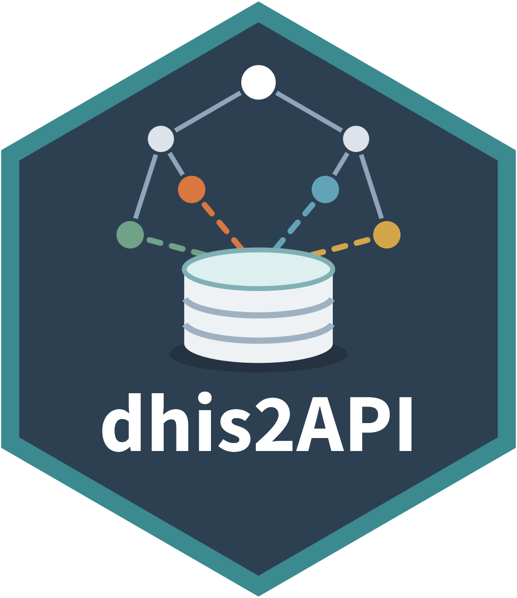

# dhis2API 

<!-- badges: start -->

[](https://github.com/truenomad/dhis2API/actions/workflows/R-CMD-check.yaml)
[](https://codecov.io/gh/truenomad/dhis2API)
[](https://cran.r-project.org/)

<!-- badges: end -->

An R client for the DHIS2 (District Health Information Software 2) Web API. It reads metadata, analytics, raw data values and tracker records. You can save aggregate data in a local DuckDB database, resume interrupted downloads and download changes on later runs.

## Installation

```r
pak::pak("truenomad/dhis2API")
```

## Credentials

Put the server address, username and password in `~/.Renviron`, then restart R:

```
DHIS2_BASE_URL=https://your.dhis2.server
DHIS2_USERNAME=your_username
DHIS2_PASSWORD=your_password
```

To use a personal access token, set `DHIS2_TOKEN` in place of the username and password. You can also store a password in the system keyring, your operating system's credential store. This command prompts for the password:

```r
dhis2API::dhis2_keyring_set("https://your.dhis2.server", "your_username")
```

Open a session once. Later calls use it automatically:

```r
dhis2API::dhis2_session()
dhis2API::dhis2_ping()
```

`dhis2_defaults()` lists settings such as the response timeout, retry count and request rate limit. Set a value for one session with `dhis2_session(timeout = 300)`, or set an R option with `options(dhis2api.timeout = 300)`. A session setting takes precedence over the R option.

## Metadata

```r
units <- dhis2API::dhis2_org_units(level = 1:5)
elements <- dhis2API::dhis2_data_elements()
combos <- dhis2API::dhis2_category_option_combos()

dhis2API::dhis2_metadata(
  "dataElements",
  fields = "id,name,valueType",
  filter = dhis2API::dhis2_filter("name", "ilike", "measles")
)
```

DHIS2 uses unique identifiers (UIDs) for data elements, organisation units and other records. `dhis2_org_units()` adds the UID and name of each unit in an organisation unit's hierarchy, including itself, as `level<n>_uid` and `level<n>_name`. For example, a facility row can include its district and province. Set `options(dhis2api.cache_dir = "cache/dhis2")` to reuse metadata saved on disk for up to a day.

## Analytics

```r
values <- dhis2API::dhis2_analytics(
  dx = elements$de_uid[1:20],
  pe = dhis2API::dhis2_monthly_periods(as.Date("2025-01-01"), Sys.Date()),
  ou = "LEVEL-5",
  dx_per_request = 10,
  pe_per_request = 3
)
dhis2API::dhis2_add_names(values, elements = elements, combos = combos)
```

If a request fails, the package splits its periods into two smaller requests and retries, up to three levels of splitting. Authentication and permission errors stop the download. Any requests that still fail produce a warning, and their data is omitted from the result.

Use `dhis2_weekly_periods()` for weekly period identifiers. It accounts for years with 52 or 53 weeks; an invalid week can cause DHIS2 to reject an entire request.

## Download aggregate data to a local database

```r
con <- dhis2API::dhis2_store_open("data/dhis2.duckdb")
districts <- dplyr::filter(units, ou_level == 3)

dhis2API::dhis2_sync_group(
  con, "antigens", districts,
  interim_dir = "data/_interim",
  window_start = as.Date("2022-01-01"),
  window_end = Sys.Date(),
  data_element_group = "your_group_uid"
)

dhis2API::dhis2_store_summary(con)
dhis2API::dhis2_store_close(con)
```

The first run downloads the full date range, one year per request, and can resume after an interruption. Later runs download recent changes, including deletions. By default, they check at least the last eight days and extend that interval to cover gaps between runs. If you extend `window_end`, add units or change the data set or group, the new history is downloaded in full while existing units keep receiving updates.

Use `dhis2_sync_analytics()` to save analytics results in the database. It can resume from saved files, but it does not check which values changed on the server. To refresh previously saved results, set `resume = FALSE`: each successful request then replaces the stored rows for its data elements, periods and organisation units, so values the server no longer returns are removed.

Saved files are tied to the server, account and request they came from, so a folder reused with another server or account is downloaded again.

To read a consistent copy while a download is writing, make the copy from the R session that holds the store open, preferably passing its connection: `dhis2_store_snapshot("data/dhis2.duckdb", "data/copy.duckdb", con = con)`. The copy includes every committed change. If another process holds the write lock, the function stops with an error instead of copying an inconsistent file.

Read selected values without loading the whole database into R:

```r
dhis2API::dhis2_store_values("data/dhis2.duckdb", element_uids, years = 2025)
```

The database separates raw values (`data_values`), monthly analytics (`analytics_values`) and weekly or daily analytics (`analytics_subannual`). These tables can contain the same data at different levels of detail. Adding values across them would double count.

## Notes

- The default request rate limit is 60 requests per minute per R process. Parallel downloads use up to six R processes by default.
- Redirects are not followed, so an expired login shows as an error instead of an HTML page read as data.
- `dhis2_tracker()` reads events, enrollments, tracked entities and relationships. Data imports and OAuth login are not supported.
